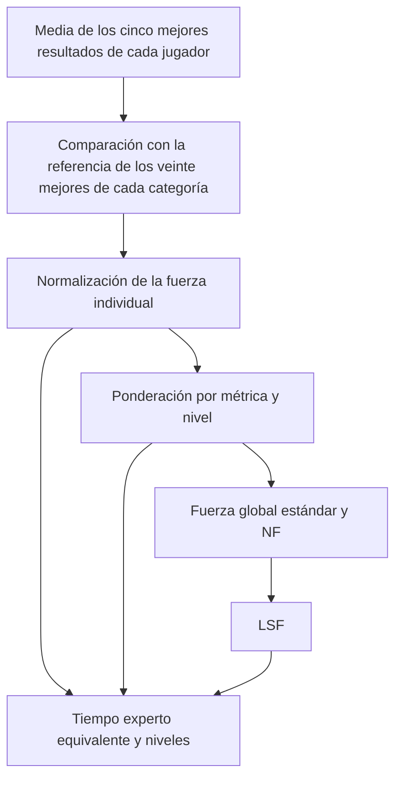

# Clasificaciones top y LSF

**Las clasificaciones top utilizan varias actuaciones destacadas; el LSF pone a nivel diferentes especialidades.**

Algunos jugadores destacan en tiempos bajos, otros en Bvs altos o en Stnb. Algunos son más fuertes en Principiante, otros en Experto. Un PB en una sola categoría no puede describir completamente esas diferencias. Las clasificaciones top y LSF conservan los resultados individuales al tiempo que ofrecen una medida combinada.

## ¿Por qué los cinco mejores resultados?

Un resultado excepcional puede reflejar habilidad, un tablero especialmente favorable o ambos. Tomar el **promedio de tus cinco mejores resultados históricos** reduce la influencia de un juego afortunado en lugar de dejar que un desempeño destacado represente tu capacidad.

Tomar demasiados resultados haría que llenar y mejorar un récord fuera innecesariamente exigente. Cinco es un equilibrio entre reducir el azar y limitar la carga de trabajo. Aún mide actuaciones fuertes, no tu promedio en todos los juegos, y no elimina por completo el azar.

Cada categoría elige sus propios cinco resultados: los cinco tiempos más bajos, los cinco valores de Bvs más altos y los cinco valores de Stnb más altos. Estos no necesitan provenir de los mismos juegos repetidos, y se permiten valores repetidos de 3BV.



## ¿Qué incluye la clasificación top?

Principiante, Intermedio y Experto tienen cada uno clasificaciones de Tiempo, Bvs y Stnb, tanto en categorías ordinarias como en NF: **18 clasificaciones en total**.

| Código | Significado |
| --- | --- |
| b, i, e | Principiante, Intermedio, Experto |
| t, b, s | Tiempo, Bvs, Stnb |
| et | Promedio de los cinco mejores tiempos en Experto |
| eb | Promedio de los cinco mejores resultados de Bvs en Experto |

Solo incluyen repeticiones en modo estándar aprobadas que no estén ocultas por un torneo. El mínimo de 3BV es **10 para Principiante, 30 para Intermedio y 100 para Experto**, para todos los tres indicadores.

Las clasificaciones ordinarias incluyen repeticiones de NF. Las clasificaciones de NF solo incluyen repeticiones con cero clics efectivos a la derecha. Cada categoría elige sus propios cinco mejores resultados, por lo que una repetición puede contribuir a ambas.

Si hay menos de cinco resultados, cada resultado de tiempo faltante se cuenta como **999.999 segundos**, y cada resultado de Bvs o Stnb faltante se cuenta como 0. El promedio sigue dividiéndose entre cinco. Un jugador con al menos una repetición válida en top participa en cada categoría, usando estos valores por defecto en los casos en que los resultados faltan.

## Anclajes y fuerza relativa

Los indicadores brutos no pueden sumarse simplemente: menor tiempo es mejor, mayores valores de Bvs y Stnb son mejores, y los tres niveles de dificultad tienen rangos numéricos diferentes. Cada clasificación tiene entonces un referente de alto nivel llamado **anclaje**.

Un anclaje es el **promedio aritmético de los mejores cinco promedios de los veinte jugadores más destacados** en esa categoría. Primero calcula el promedio de los cinco resultados de cada jugador, luego promedia los veinte jugadores, en lugar de tomar los veinte mejores juegos individuales en toda la plataforma. Cada categoría puede tener diferentes jugadores destacados; las categorías ordinarias y de NF también tienen anclajes separados.

Deja intactos todos los marcadores `V`, `A`, etc.; cada uno representa código literal. Los ratios de fortaleza individual son:

| Métrica | Relación de fuerza |
| --- | --- |
| Tiempo | `A / V` |
| Bvs | `V / A` |
| Stnb | `(V / A)^(1/1.7)` |

Mayor es siempre mejor, y **1 significa coincidir con el ancla de esa categoría**. La potencia `1/1.7` hace que Stnb se escalen de forma consistente con la velocidad: en el mismo tablero, el mismo aumento proporcional de velocidad produce el mismo aumento proporcional en todas las tres razones de fuerza.

Los anclajes cambian cuando los resultados mejoran o dejan las clasificaciones. Por consiguiente, resultados personales inalterados pueden recibir diferentes puntuaciones de fuerza, tiempos equivalentes o niveles. Estos son mediciones relativas, no estándares absolutos permanentes.

## De la fuerza individual a LSF

Cada nivel tiene una fuerza ponderada, usando los siguientes pesos directamente:

| Nivel | Tiempo | Bvs | Stnb |
| --- | --- | --- | --- |
| Para principiantes | 32 | 48 | 20 |
| Intermedio | 36 | 36 | 28 |
| Experto | 32 | 32 | 36 |

Coincidir con los tres anclajes da una fuerza de nivel de **100**.

Luego combina los niveles, seguido de la fuerza ordinaria y NF:

```text
Overall strength = Beginner strength × 6 + Intermediate strength × 14 + Expert strength × 20
LSF = Ordinary overall strength × 0.97 + NF overall strength × 0.03
```

Los tres niveles y la fuerza general se clasifican por separado en juego ordinario y NF. Juntos con LSF, estos forman **9 clasificaciones derivadas**. Coincidir con cada anclaje correspondiente da una fuerza general y valores de LSF de **4000**.

LSF ofrece una comparación general sin reemplazar las especialidades subyacentes. Dos jugadores pueden tener el mismo LSF mediante combinaciones diferentes de métricas y niveles. Los resultados individuales y los gráficos de radar del perfil siguen proporcionando contexto útil.

## Equivalente et: Una escala compartida

Comparar una fuerza de nivel de 100 con una fuerza general de 4000 no es intuitivo. **Equivalente et** convierte la fuerza individual, de nivel y general en la misma escala de tiempo experto, así que los jugadores con diferentes especialidades pueden discutir su capacidad usando un estándar común.

Primero normaliza la fuerza: divide la relación individual entre 1, la fuerza de nivel entre 100 o la fuerza general entre 4000. Deja que el resultado normalizado sea `r`, y el anclaje correspondiente de et sea `A_et`:

```text
Equivalent et = A_et / r
```

**Categorías ordinarias usan el anclaje de et ordinario; categorías NF usan el anclaje de et NF.** Los niveles usan la misma selección de referencia. Las relaciones de fuerza siguen usando sus propios anclajes específicos de métricas ordinarias o NF.

Con un anclaje de et ordinario de 30 segundos, una fuerza normalizada ordinaria de 1 equivale a un equivalente et de 30 segundos; 1.5 equivale a 20 segundos; y 0.5 equivale a 60 segundos. Si el anclaje de et NF es de 60 segundos, una fuerza normalizada NF de 1 equivale a un equivalente et de 60 segundos. Un equivalente et más bajo significa un desempeño más fuerte.

El equivalente et es una escala de clasificación, **no un PB real de experto ni una promesa de que un jugador pueda alcanzar ese tiempo**. Un jugador que excela en Bvs, Stnb o Principiante puede alcanzar un equivalente et fuerte mediante esas fortalezas.

## Niveles: Nombrar la escala

Los niveles dividen el equivalente et en los siguientes intervalos, con un número de etapa que muestra el progreso dentro de cada intervalo:

| Equivalente et E (segundos) | Nivel |
| --- | --- |
| E > 100 | Novato |
| 60 < E <= 100 | Zapador |
| 55 < E <= 60 | Divinidad menor |
| 50 < E <= 55 | Divinidad mayor |
| 45 < E <= 50 | Arquidivinidad menor |
| 40 < E <= 45 | Arquidivinidad mayor |
| 35 < E <= 40 | Dios supremo menor |
| 30 < E <= 35 | Dios supremo mayor |
| E <= 30 | Extraterrestre |

Los niveles utilizan **interpolación lineal en intensidad, no en segundos**. El extremo más débil comienza en 0 y se acerca a 10 hacia el extremo más fuerte, mostrado con una cifra decimal, por ejemplo `Greater Archdeity 3.2`. Al alcanzar una frontera, el jugador pasa al nivel 0 del nivel más fuerte.

Alien comienza en la etapa 0 a 30 segundos y alcanza la etapa 10 a 25 segundos. Resultados más fuertes continúan más allá de la etapa 10. La fuerza cero es Novato 0.0, con equivalente et infinito.

La tabla LSF muestra las categorías en sus ocho columnas de fuerza, mientras que el valor LSF permanece numérico. Las etiquetas de tabla acortan 'Mayor' / 'Menor' a G. / L., por ejemplo `G. Archdeity 3.2`. Posiciona el cursor sobre una celda de categoría para ver su título completo y su equivalente et. **Las categorías solo afectan la visualización, no el orden de clasificación basado en fuerza.**
